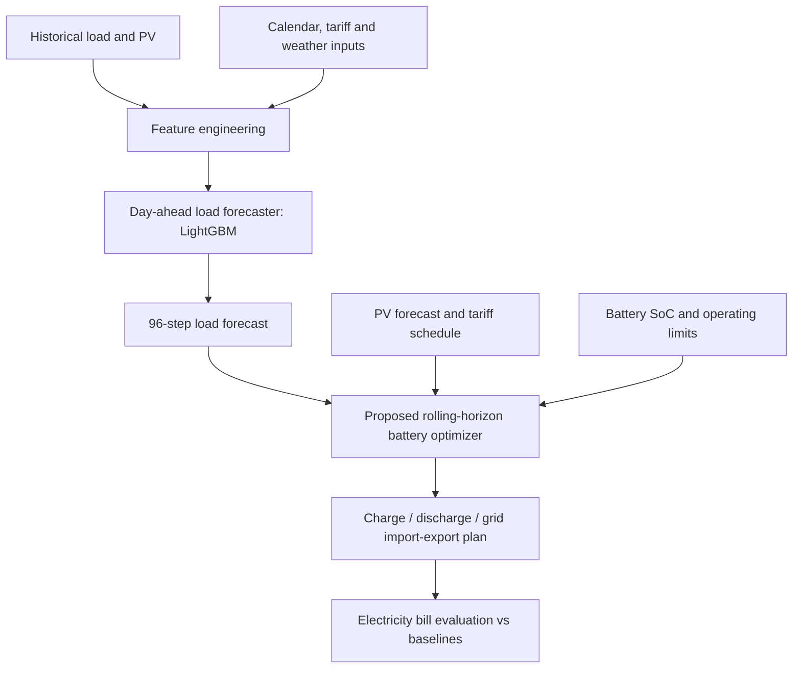

# ⚡ EnergyAI Optimizer

### Day-ahead residential load forecasting & battery dispatch optimization

**Applied Machine Learning · Energy Systems · Time-Series Forecasting · Optimization**  
Developed for **Solship company, an Italy-based startup specializing in AI-driven energy optimization** ·

    

> **Project snapshot:** Built and evaluated a 15-minute-resolution residential electricity load forecaster using historical consumption, calendar, tariff, solar, and weather information. The forecasting component supports a proposed day-ahead battery scheduling system designed to reduce time-of-use electricity costs while respecting grid and battery constraints.

## Highlights

| Metric | Result | Evaluation period |
|:--|--:|:--|
| **Best reported validation NRMSE** | **3.5589%** | Oct–Dec 2024 |
| **Held-out test NRMSE** | **7.7404%** | April 2025 |
| **Held-out test NRMSE** | **7.5726%** | September 2025 |
| Forecast resolution | **15 minutes** | 96 intervals per day |
| PV / battery capacity | **9 kWp / 16 kWh** | System specifications |

*Metrics above are for **LightGBM load forecasting**. They are not savings, optimization performance, or guarantees of future accuracy.*

## 1. Problem & Motivation

A solar-powered residential site in **Sondrio, Italy**, must decide when to charge a battery, use stored energy, buy from the grid, and export excess solar generation. Consumption and photovoltaic production vary throughout the day, while electricity import prices depend on Italian **F1/F2/F3 time-of-use** tariff bands.

The project addresses two connected questions:

1. **Prediction:** Can we estimate the next day's electricity demand at every 15-minute interval?
2. **Decision-making:** How can those forecasts guide a battery dispatch schedule that reduces the electricity bill without violating operating limits?

### Energy system specifications

| Component | Specification |
|:--|:--|
| Rooftop photovoltaic installation | 9 kWp |
| Lithium battery | 16 kWh usable model capacity |
| Battery power limit | ±8 kW charge/discharge |
| Battery round-trip efficiency | 90% |
| Grid import/export limit | ±6 kW |
| Tariff | Italian F1 / F2 / F3 time-of-use bands |
| Decision interval | 15 minutes (`Δt = 0.25 h`) |
| Planning horizon | 96 steps (24 hours) |

## 2. System Architecture



**Implementation boundary:** The material provided documents a trained/evaluated forecasting component and a **written mathematical formulation** for dispatch. It does **not** establish that an optimizer has been implemented, executed, or benchmarked against baselines. The optimization path in the diagram is therefore a proposed integration, not a verified completed result.

## 3. Data & Evaluation Protocol

The data was divided chronologically to separate model development from final evaluation.

| Split | Period | Role |
|:--|:--|:--|
| Training | January–September 2024 | Model fitting |
| Validation | October–December 2024 | Model selection and tuning |
| Test | April 2025 | Held-out seasonal evaluation |
| Test | September 2025 | Held-out seasonal evaluation |

**No 2025 observations were used for fitting or hyperparameter tuning**, according to the supplied project methodology. Avoid random train/test splits for time-series forecasting.

### Forecast horizon and causality

- **Target:** electrical load in kW at 15-minute resolution.
- **Forecasting objective:** produce a 96-step prediction for the **entire following day** before dispatch is scheduled.
- **Design requirement:** historical load and PV features must be available at prediction issue time. Day-ahead weather and prices must be forecasts/known schedules, not realized future measurements.

> **Reproducibility audit needed:** The supplied feature-importance figure includes names such as `load_lag_1`, `load_lag_2`, `load_ramp_rate` and `net_load`, which may be inconsistent with a strict *96-step day-ahead* information set if calculated from observations within the predicted day. Before claiming zero intra-day leakage, verify the exact feature-building code and whether those values are generated only from data available before the forecast issue time. The reported scores are presented as supplied; this README does not independently validate their leakage-free status.

## 4. Feature Engineering

| Category | Representative features | Rationale |
|:--|:--|:--|
| **Calendar** | `hour`, `dow`, `month`, `step_of_day`, weekend/holiday flags | Capture recurring consumption patterns |
| **Cyclical encodings** | `sin_hour`, `cos_hour`, day/week/year cyclic encodings | Preserve time periodicity |
| **Tariff information** | `band_int`, `price_spread`, `mins_until_band_change` | Align demand patterns with price schedules |
| **Historical demand** | `load_lag_96`, `load_lag_192`, `load_lag_672` | Same interval from previous days / week |
| **Rolling load statistics** | Historical mean, std, max, min, EWMA | Describe demand level and variability |
| **Solar and net demand** | `pv_lag_96`, `pv_lag_672`, historical net load/PV surplus | Reflect local generation and consumption interaction |
| **Weather** | Temperature, cloud coverage, solar radiation, lagged temperature | Explain temperature- and sunlight-dependent behavior |
| **Interactions** | `temp_x_step`, `temp_x_iswork`, `load_trend_week` | Capture nonlinear temporal effects |

Weather features are based on **Sondrio, Italy**. For true day-ahead deployment, same-day weather values must come from a forecast issued before the scheduling horizon.

### Feature importance (LightGBM)


The model's importance ranking emphasizes consumption-related variables, short-term changes, and time-of-day features. **Feature importance is not proof of causality**; the plotted short-lag feature names should be checked against the stated day-ahead forecasting setup.

## 5. Modeling

### LightGBM (primary reported model)

```python
from lightgbm import LGBMRegressor

model = LGBMRegressor(
    n_estimators=2000,
    learning_rate=0.02,
    max_depth=8,
    num_leaves=127,
    subsample=0.8,
    colsample_bytree=0.8,
    min_child_samples=20,
    reg_alpha=0.05,
    reg_lambda=0.5,
    random_state=42,
)
```

The supplied visualizations also compare **XGBoost**, **LightGBM**, and an **ensemble**. However, the provided numerical summary reports metrics only for LightGBM; no model-by-model benchmark is asserted here.

### Learning curve


Training error decreases as boosting iterations increase. Validation RMSE reaches a relatively flat region near **0.057 kW** while training RMSE continues to decline. The plotted run ends at **2,000 estimators**; the endpoint is the labeled best iteration in the figure, but by itself it does not demonstrate that 2,000 is a global optimum.

## 6. Forecasting Results

### Quantitative results

| Split | Period | RMSE (kW) ↓ | MAE (kW) ↓ | NRMSE (%) ↓ |
|:--|:--|--:|--:|--:|
| Validation | Oct–Dec 2024 | 0.0569 | 0.0185 | **3.5589** |
| Held-out test | April 2025 | 0.0746 | 0.0381 | **7.7404** |
| Held-out test | September 2025 | 0.0635 | 0.0331 | **7.5726** |

**Interpretation:** The model closely tracks many load changes and peaks, with a larger normalized error on the two 2025 test periods than on validation. Some of the largest residuals occur around abrupt changes in demand. These are *load prediction* metrics, not battery control outcomes.

### Held-out test: April 2025


The top panel compares actual and predicted load across the second week of April; the lower panel shows ensemble residuals (`actual − predicted`) for this visual comparison.

### Held-out test: September 2025


The forecast follows repeated load spikes while the residual series highlights instances of under- and overprediction. **These residual plots are labeled as ensemble errors**, whereas the numerical table reports **LightGBM** metrics; do not treat them as interchangeable.

### Actual vs predicted: both test months


The dashed diagonal represents perfect prediction. Points clustered close to the line indicate a strong agreement between measured and predicted consumption; high-load deviations remain visible.

### Full-month and selected-week views


These plots show seasonal consistency across April and September, while also highlighting difficult, high-variability periods.

### Validation example: October 2024


The validation visual compares actual, LightGBM, XGBoost, and ensemble forecasts and their residuals during October 2024. It illustrates qualitative model agreement; no additional model-specific metrics are inferred from the lines alone.

## 7. Evaluation Metrics

Let `y_t` be observed load and `ŷ_t` predicted load over `N` points:

**Root mean squared error (RMSE)**

```text
RMSE = sqrt((1/N) * Σ(y_t - ŷ_t)^2)
```

**Mean absolute error (MAE)**

```text
MAE = (1/N) * Σ|y_t - ŷ_t|
```

**Normalized RMSE (NRMSE)**

```text
NRMSE (%) = 100 * RMSE / mean(y_t)
```

NRMSE is the primary forecasting ranking criterion in the original challenge. Its denominator is the **mean actual load for the corresponding evaluation subset**; it is not normalization by peak load.

## 8. Battery Dispatch Optimization

The next component uses the day-ahead demand forecast, photovoltaic estimates, import/export tariffs, and current battery state of charge to schedule energy flows over 96 intervals.

### Objective: minimize net electricity cost

With separate nonnegative grid import `g_import,t` and export `g_export,t`:

```text
minimize Σ_t [buy_price_t * g_import,t - sell_price_t * g_export,t] * Δt

where Δt = 0.25 h,  t = 1, ..., 96
```

A billing objective may require additional fixed charges or jurisdiction-specific settlement rules if supplied by the challenge; these are not specified in the materials provided.

### Operating constraints

Define nonnegative battery charging power `p_ch,t` and discharging power `p_dis,t`.

```text
0 ≤ g_import,t ≤ 6 kW
0 ≤ g_export,t ≤ 6 kW
0 ≤ p_ch,t ≤ 8 kW
0 ≤ p_dis,t ≤ 8 kW
0 ≤ SoC_t ≤ 1
SoC_initial = 0.5

load_t + p_ch,t + g_export,t = pv_t + p_dis,t + g_import,t

SoC_(t+1) = SoC_t
            + (sqrt(0.90) * p_ch,t * Δt / 16)
            - (p_dis,t * Δt / (sqrt(0.90) * 16))
```

**Important modeling note:** Separate nonnegative import/export and charge/discharge variables are convenient for linear optimization, but **simultaneous import and export** or **simultaneous charge and discharge** must be prohibited or shown economically non-beneficial. Binary mode variables and a **MILP** are one robust way to enforce physical exclusivity. Also ensure grid limits and SoC terminal conditions match the actual operational specification.

### Daily rolling-horizon process

1. Generate 96 load estimates for the next day.
2. Provide expected PV production, tariff prices, and initial battery SoC.
3. Solve a constrained LP/MILP using **CVXPY** or **PuLP**.
4. Execute the selected schedule and update state for the next horizon.
5. Compare realized energy bills with the competition's **two baselines** once defined and implemented.

## 9. Repository Layout

Place `README.md` in the repository root, alongside the **`Results`** directory. GitHub displays all seven figures inline using the relative paths above. Paths are case-sensitive: keep the directory name `Results` with a capital `R`.

```text
EnergyAI_Optimizer/
├── README.md
├── .gitignore
└── Results/
    ├── forecast_vs_actual_apr_sep.png
    ├── lgbm_feature_importance.png
    ├── lgbm_loss_curve.png
    ├── scatter_actual_vs_predicted.png
    ├── test_forecast_april2025.png
    ├── test_forecast_sep2025.png
    └── val_forecast_oct2024.png
```

